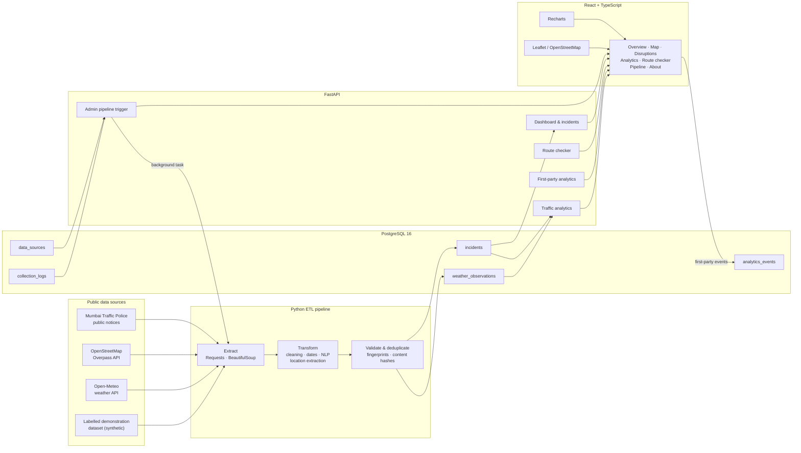
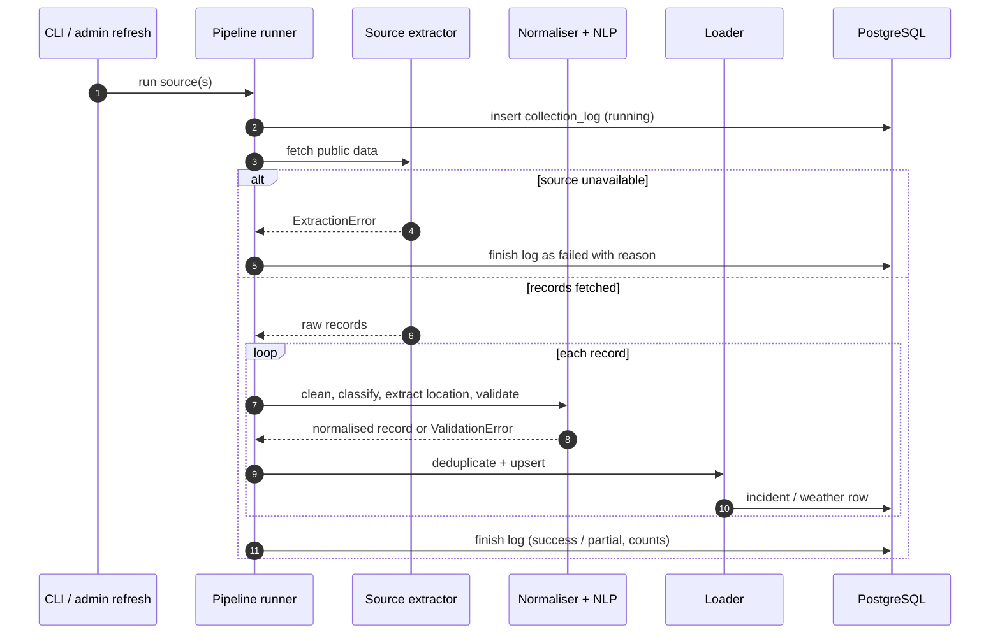
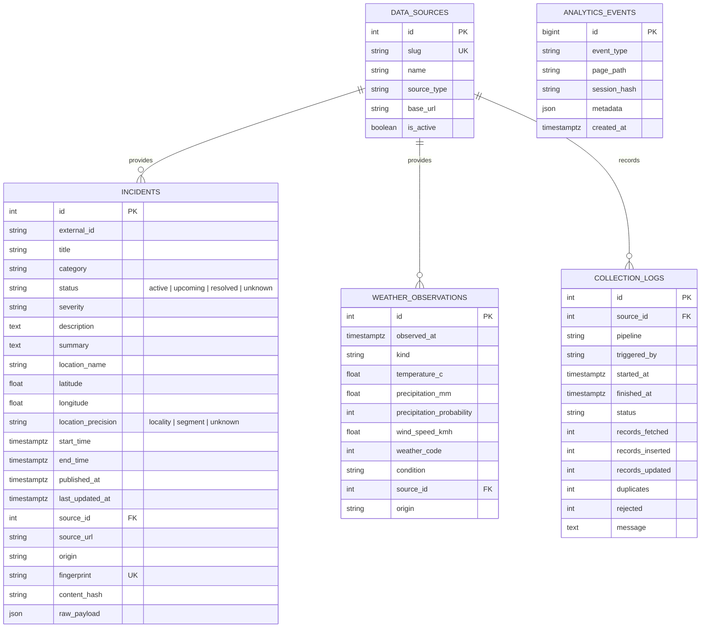
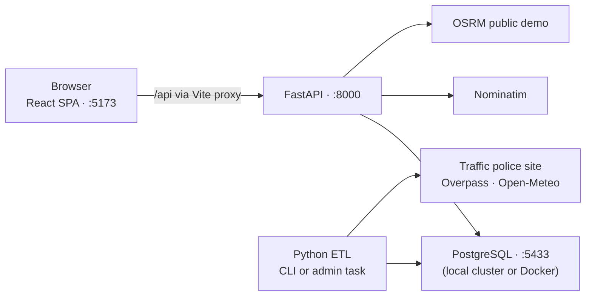

# UrbanFlow — System Architecture & Data Flow

UrbanFlow is a local-first, monorepo application. It deliberately avoids microservices,
queueing systems and distributed infrastructure so that every component can be explained and
run by a student team.

## 1. System architecture

External services used at request time:

- **Nominatim** for address geocoding when a location is not in the Mumbai gazetteer.
- **OSRM** for route geometry, distance and free-flow duration estimates.

## 2. Collection and ingestion flow

Every attempt writes fetched, inserted, updated, duplicate and rejected counts. A failed source
never produces substitute records.

## 3. Data model

Indexes cover incident category/status, start time, location and coordinates, weather observation
time, collection log time, and analytics event type/time. Constraints enforce valid origins,
statuses, weather kinds and unique weather observations/fingerprints.

PostGIS is **not** used. The application only needs centroid-level proximity checks, which are
implemented with haversine and local planar projection. This keeps setup simple; a future version
could introduce PostGIS for road-network snapping.

### Status semantics and uncertainty

- Time-based sources produce `active`, `upcoming` or `resolved` statuses from their published start
  and end dates.
- OpenStreetMap construction tags do not publish a confirmed operational status, so those records
  are stored as `unknown` and are never counted as active disruptions. Their coordinates are the
  OSM road-segment centre (`location_precision = "segment"`), not an incident position.
- Unknown statuses are preserved by the startup status refresh.
- The dashboard construction KPI separately reports active records and OSM-mapped construction.

### Weather source semantics

Open-Meteo's archive endpoint is the only source of `kind = "observed"` records. The forecast
endpoint supplies current and future forecast days; overlapping days never overwrite archive
observations and are never relabelled as observed. Weather/incident analytics therefore compare
incidents with archive observations only, while the dashboard outlook uses forecast records.

### Route relevance window

Unknown-status OSM records are matched to a route only when their OSM last-edit date is within the
last 12 months. Older mapped records remain visible in the historical table and map, but are not
presented as current route hazards.

## 4. Text analytics

1. Strip HTML and normalise whitespace.
2. Tokenise with NLTK's Treebank tokenizer and remove English stop words (bundled fallback if NLTK
   corpora are unavailable).
3. Fit TF-IDF features (unigrams and bigrams) on a small, in-repository labelled corpus.
4. Train a linear SVM (scikit-learn) for the seven incident categories.
5. Apply transparent keyword rules as a guardrail when they strongly agree, and as a fallback when
   the model is unavailable.
6. Extract locations via longest-match against the Mumbai gazetteer.
7. Produce a deterministic extractive summary.

The classifier is intentionally small and inspectable rather than a downloaded transformer. Its
method and confidence are stored in the processed record metadata.

## 5. Query and presentation flow

- React fetches typed JSON from FastAPI. There is no server-side rendering and no mocked data in
  the UI.
- Dashboard statistics, timelines, category splits, location counts and analytics series are
  computed from SQL queries over `incidents` and `weather_observations`.
- Leaflet renders only records with non-null coordinates. Records store whether their location is
  an OpenStreetMap road-segment centre (`segment`) or an approximate locality centroid (`locality`).
  OSM construction records keep `status = "unknown"` because OSM does not confirm an operational
  closure.
- The route checker calls OSRM, then matches active, upcoming and status-unknown records to the
  route polyline within a 350 m corridor. Alternative routes are only shown when returned by OSRM.
- The browser records page views, searches, filter use, map interactions, incident views and route
  checks through a first-party endpoint. No IP address, user agent, cookie or account identifier is
  stored; the session identifier is hashed before persistence.

## 6. Runtime topology

The deployment is intentionally single-machine. There is no Kafka, Kubernetes, Redis or cloud
infrastructure in the required path.
